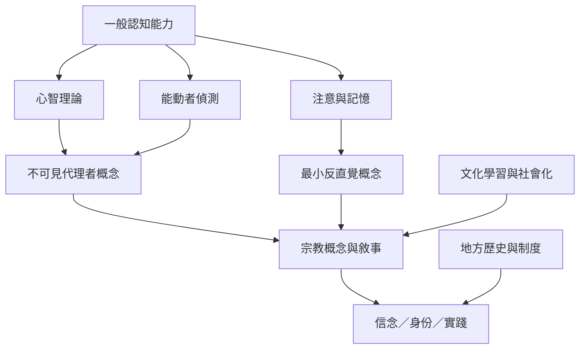

本圖整理認知宗教科學如何從一般認知能力切入，理解宗教概念如何被形成、記憶與傳遞。這些機制是可能條件，不代表宗教只由認知偏誤造成。

## 概念關聯
[[認知宗教科學]]、[[心智理論]]、[[能動者偵測]]、[[最小反直覺概念]]、[[文化學習]]、[[宗教社會化]]、[[預測處理]]。

本圖的關鍵提醒是：普遍認知能力不會自動決定具體宗教內容；文化與歷史將可能性轉化為地方傳統。參考 [[宗教的普遍性與多樣性需要認知與文化共同解釋]]。
