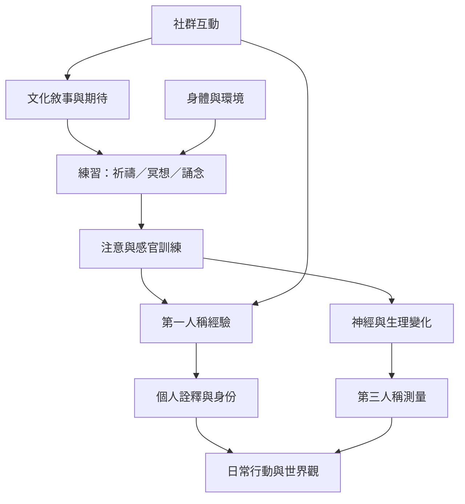

本圖將宗教經驗放在身體、注意、文化訓練與神經活動的多層次關係中。神經機制是重要證據之一，但不等同於經驗的全部意義，也不直接裁決形上真偽。

## 概念關聯
[[宗教經驗]]、[[具身認知]]、[[4E認知]]、[[生成論]]、[[預測處理]]、[[神經神學]]、[[第一人稱方法]]。

延伸閱讀 [[信仰是被練習出來的關係感不只是命題相信]]、[[腦活動關聯不能裁決靈性經驗真偽]] 與 [[研究宗教必須把當事人經驗與學術分析並置]]。
