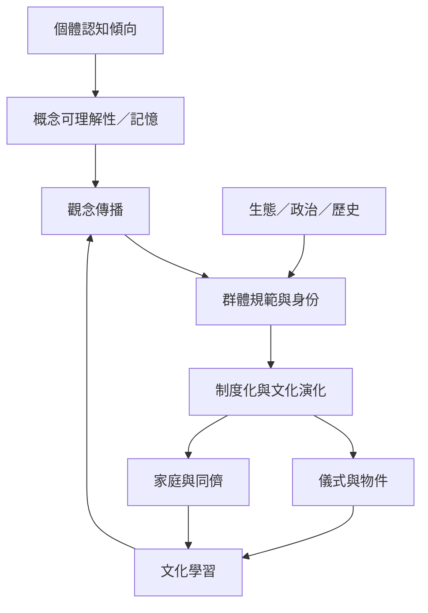

本圖把個體認知、社會學習、傳播選擇與制度變化放在同一個過程中。宗教觀念能否被記住只是其中一環，是否獲得權威、資源與持續的共同實踐同樣重要。

## 概念關聯
[[文化演化]]、[[文化學習]]、[[宗教多樣性]]、[[社會化]]、[[宗教社會化]]、[[道德化超自然者]]、[[無神論]]。

閱讀時可對照 [[文化學習與認知偏誤共同塑造宗教信念]] 與 [[宗教信仰與不信仰有多條認知與文化形成路徑]]。
