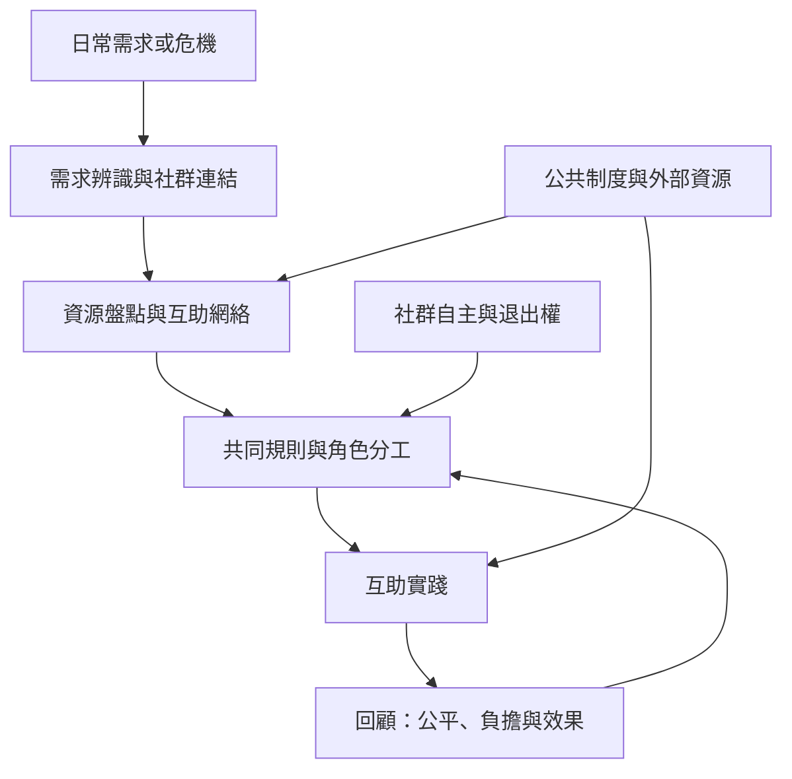

互助與日常協作能把集體行動從大型抗爭擴展到照護、共餐、共享資源與災害回應。互助的持續性仰賴信任、互惠、合理分工、社群認受性與公共機構的適當支持。這張地圖可用來設計低門檻的地方實驗，同時檢查照護成本與權力分配。

延伸：[[互助網絡在危機中能補足正式制度的反應缺口]]、[[外部資源應強化而非取代社群的行動主體性]]、[[集體行動的成效必須檢視誰承擔成本與誰取得權力]]、[[把日常共餐設計成低門檻的互助與共同治理練習]]。

本書導讀：[[Collective_action]]。
