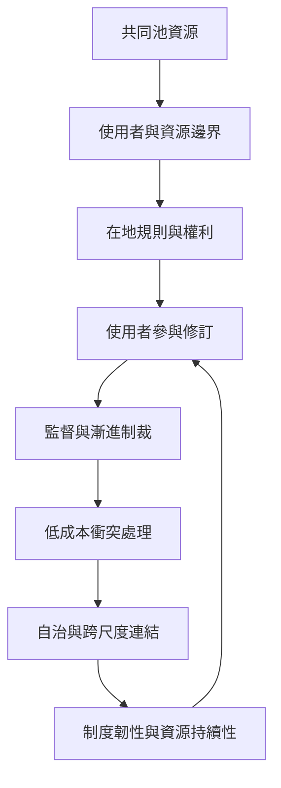

共同池資源具有使用競爭與排除困難的特徵，容易引發使用者之間的社會困境。Ostrom 的研究重點不是尋找一條萬用規則，而是理解邊界、在地規則、參與式修訂、監督、漸進制裁、衝突處理、自治權與多層次治理如何組合。尼泊爾、日本、納米比亞等案例有助比較不同制度的適切性。

延伸：[[共同資源研究顯示社群能透過制度避免公地悲劇]]、[[共同資源治理需要一組互相支撐的制度原則]]、[[在地使用者參與制定規則能提高制度適切性]]、[[監督與漸進制裁能降低違規而不必立即排除成員]]、[[多中心治理能讓不同尺度的組織互補]]。

本書導讀：[[Collective_action]]。
