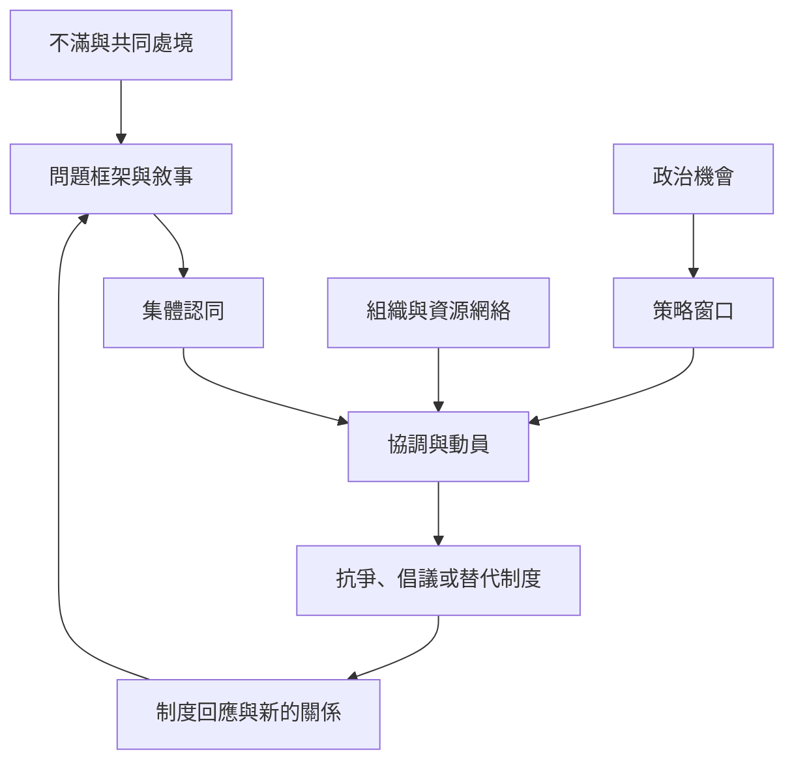

社會運動不是單一團體突然出現，而是政治條件、組織資源、敘事框架、集體認同與跨群體連結交互作用的過程。巴西 MST、南非 Abahlali、全球抗議資料及數位連結式行動，呈現不同的組織方式與行動節奏。分析時要同時看動員成果與組織內部權力。

延伸：[[社會運動應從互動機制而非單一事件理解其形成與變化]]、[[政治機會只有透過組織與敘事才會轉化為動員]]、[[社會運動透過中介連結與集體認同擴大規模]]、[[數位連結行動降低參與門檻但未必形成持久組織]]。

本書導讀：[[Collective_action]]。
