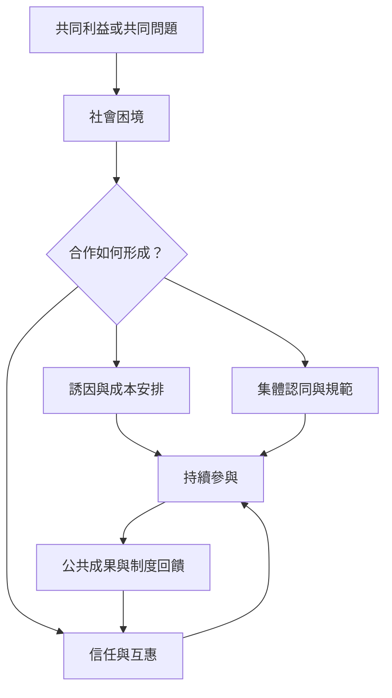

本概念地圖整理集體行動從個人選擇、社會困境到合作規範的機制。Olson 的搭便車分析是重要起點，但 Ostrom 的研究顯示互惠、信任、共同規則與情境知識能改變合作條件。讀者可先讀[[搭便車會侵蝕大型群體的公共利益供給]]，再連到[[互惠與聲譽能讓合作在重複互動中延續]]及[[群體認同能把分散的不滿轉化為共同承諾]]。

延伸：[[集體行動理論從個人誘因解釋公共利益為何難以自發供給]]、[[合作規範與條件合作者能解釋人們如何克服社會困境]]、[[集體行動理論不能只用自利模型解釋合作]]、[[小團體較易建立互信但大型行動需要跨組織協作]]。

本書導讀：[[Collective_action]]。
