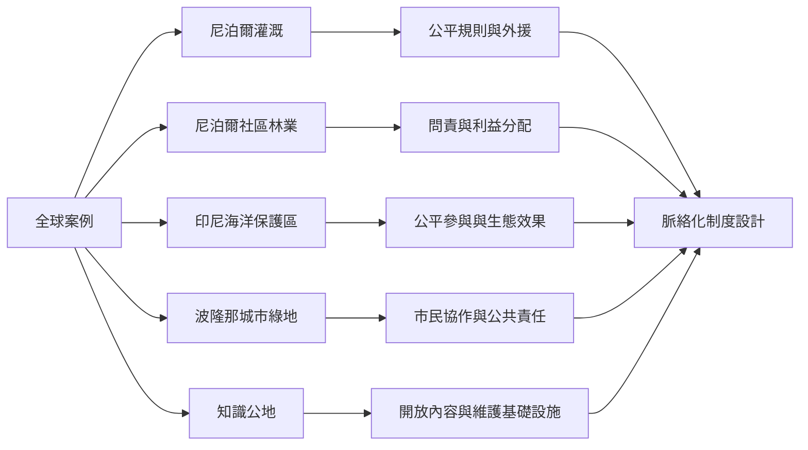

全球案例顯示，治理模式會隨資源、尺度與歷史變化。尼泊爾灌溉和社區林業強調地方使用者組織；印尼海洋保護區結合生態監測與公平參與；波隆那將城市綠地納入市民協作；知識公地則重新界定共享內容與基礎設施。比較時應尋找可轉譯的機制，而非尋找一個通用制度。

相關概念：[[共同池資源]]、[[社區林業]]、[[共同管理]]、[[城市公地]]、[[知識公地]]、[[社會生態系統]]。

## 參考
* [[尼泊爾灌溉系統三十年追蹤凸顯公平規則與外部支持]]、[[FECOFUN將尼泊爾森林使用者組織成跨地方聯邦網絡]]、[[印尼海洋保護區顯示公平參與有助於生態治理成效]]、[[波隆那的城市綠地透過市民協作成為城市公地]]、[[知識公地框架把共同治理延伸至科學與開源軟體]]。
