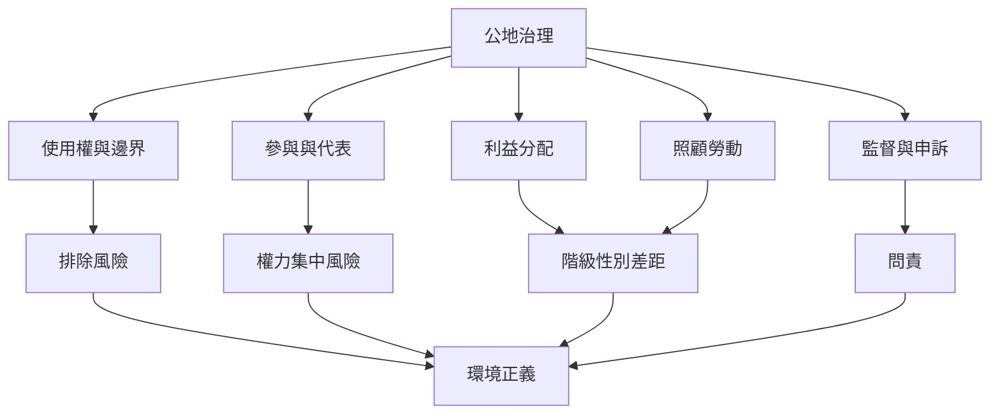

公地不是自動平等的空間。邊界決定誰能進入，代表制度決定誰能發言，利益分配決定誰受益，照顧勞動決定誰承擔維持成本。公平治理需要把這些權力關係帶入制度設計，而不是在資源管理完成後才補充社會影響評估。

相關概念：[[環境正義]]、[[公地掠奪]]、[[共同化]]、[[公地治理]]、[[集體行動]]。

## 參考
* [[公地研究必須分析階級性別種族與殖民關係]]、[[公地內部也可能出現排除與資源攫取]]、[[共同化必須把照顧勞動與權力差異納入治理]]。
