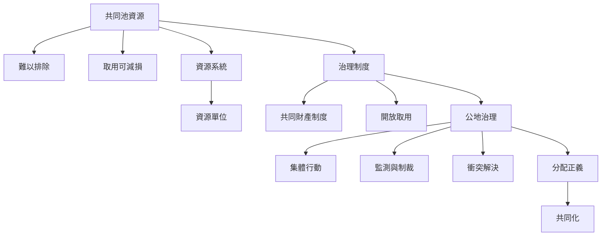

共同池資源研究從資源本身的難排他與可減損性出發，但真正決定結果的是資源、使用者、規則與更大環境的互動。閱讀本圖時，先分辨資源類型，再理解制度如何組織使用與維護，最後檢視治理結果是否公平且持續。

相關概念：[[共同池資源]]、[[公地]]、[[共同財產制度]]、[[開放取用]]、[[可減損性]]、[[可排他性]]、[[集體行動]]、[[公地治理]]、[[共同化]]。

## 參考
* [[共同池資源具有難排他與可減損兩個關鍵特徵]]、[[公地悲劇的問題在於開放取用而非共有本身]]。
