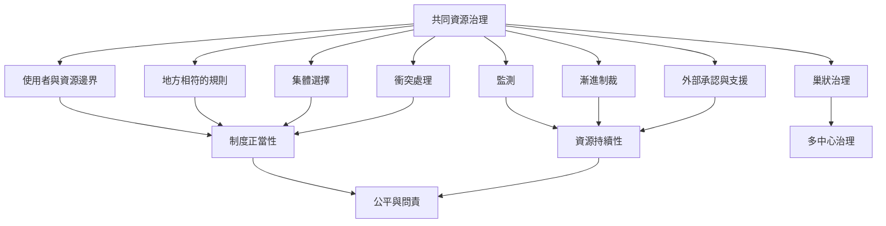

治理制度將抽象的合作問題轉為可執行的規則：辨識使用者和資源邊界、讓受影響者參與規則制定、監測資源與使用者、以漸進制裁維持規則，並建立低成本的衝突處理。這些機制要依地方條件調整，也需要外部承認與適當支援。

相關概念：[[奧斯特羅姆設計原則]]、[[制度分析與發展框架]]、[[多中心治理]]、[[共同管理]]、[[森林權屬]]。

## 參考
* [[奧斯特羅姆設計原則是穩健制度的經驗線索而非標準答案]]、[[尼泊爾灌溉系統三十年追蹤凸顯公平規則與外部支持]]。
