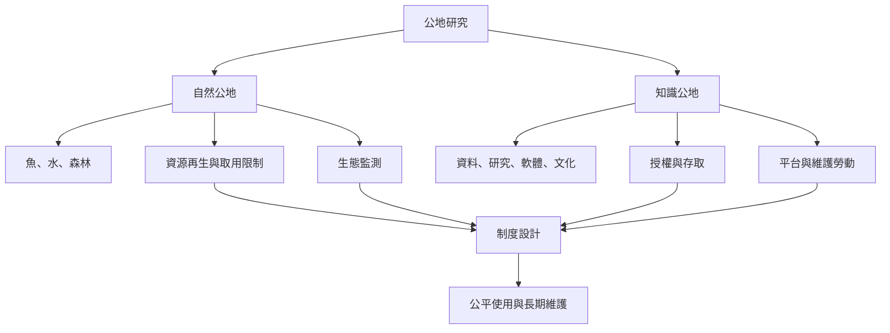

自然公地的資源單位通常會因取用而減少，治理核心包括再生能力、使用量與生態監測；知識公地的內容多可被重複使用，但存取、授權、平台容量、編輯與保存維護仍然稀缺。兩者可以共享制度分析工具，卻不能假設資源的稀缺機制完全相同。

相關概念：[[共同池資源]]、[[知識公地]]、[[開放取用]]、[[公共財]]、[[共同化]]。

## 參考
* [[知識公地框架把共同治理延伸至科學與開源軟體]]、[[共同池資源與知識公地不可直接等同]]。
