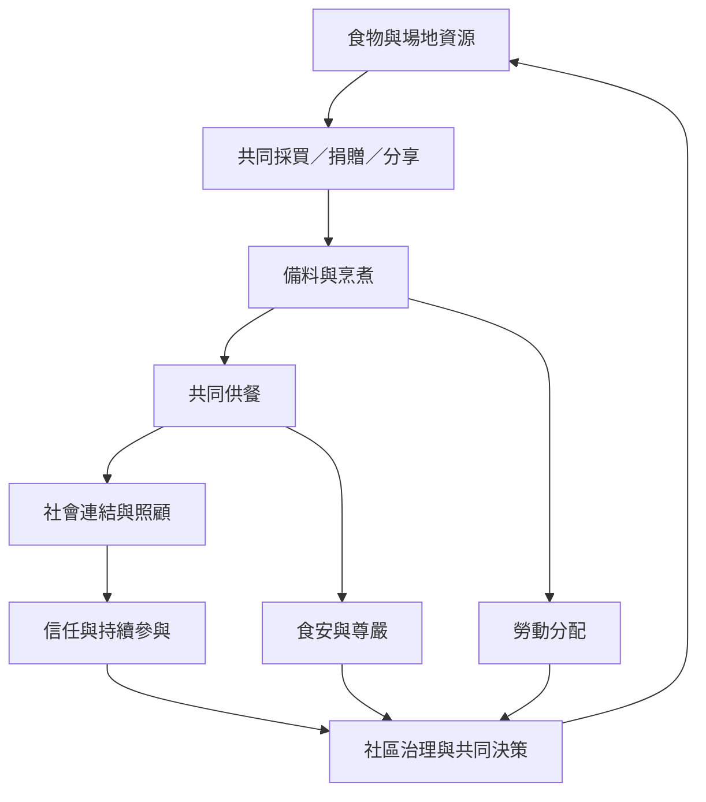

共同供餐不是只有餐點產出，而是由資源、勞動、治理、互惠與信任組成的照顧基礎設施。

概念連結：[[共同供餐與社區廚房]]、[[互助 Mutual aid]]、[[照顧倫理 Care ethics]]、[[社會再生產 Social reproduction]]、[[社區廚房是危機時期的照顧基礎設施]]、[[共食的勞動與資源應由參與者共同承擔]]。

知識書導讀：[[Communal_meal]]
