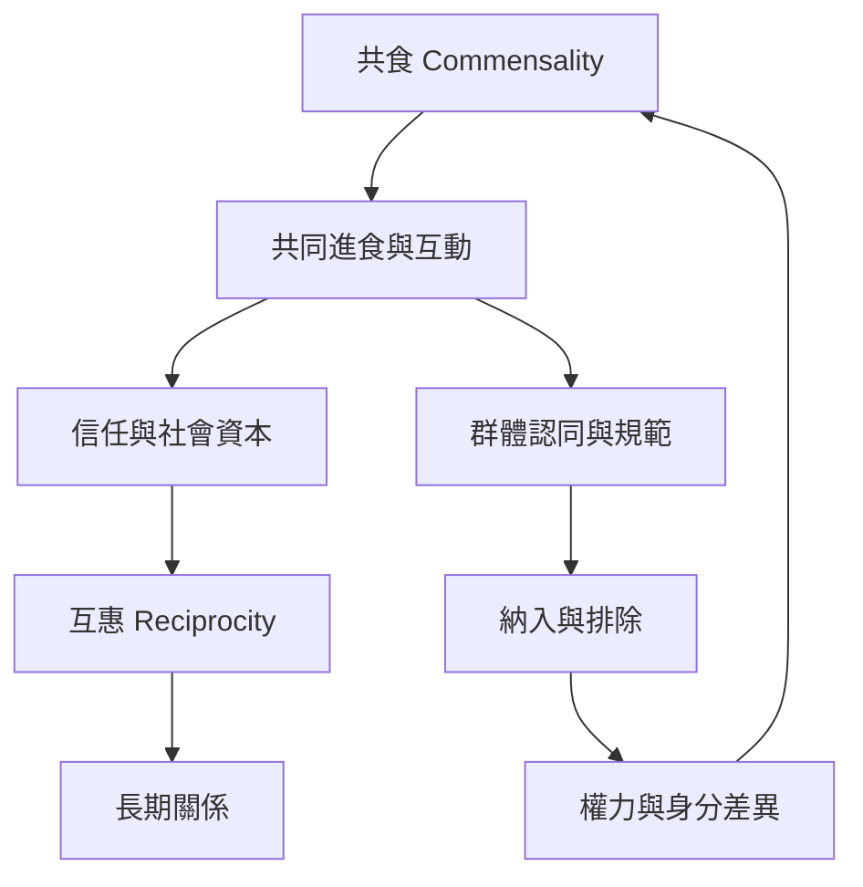

共食可同時建立連結、形成規範及畫出群體邊界。理解它需要把微觀互動、社會資本與群體排除放在同一張圖上。

概念連結：[[共食 Commensality]]、[[社會資本 Social capital]]、[[互惠 Reciprocity]]、[[共食建立連結也會畫出群體邊界]]、[[共餐規則決定參與者能否自在]]、[[共食的平等必須落實在座位與分配規則]]。

知識書導讀：[[Communal_meal]]
