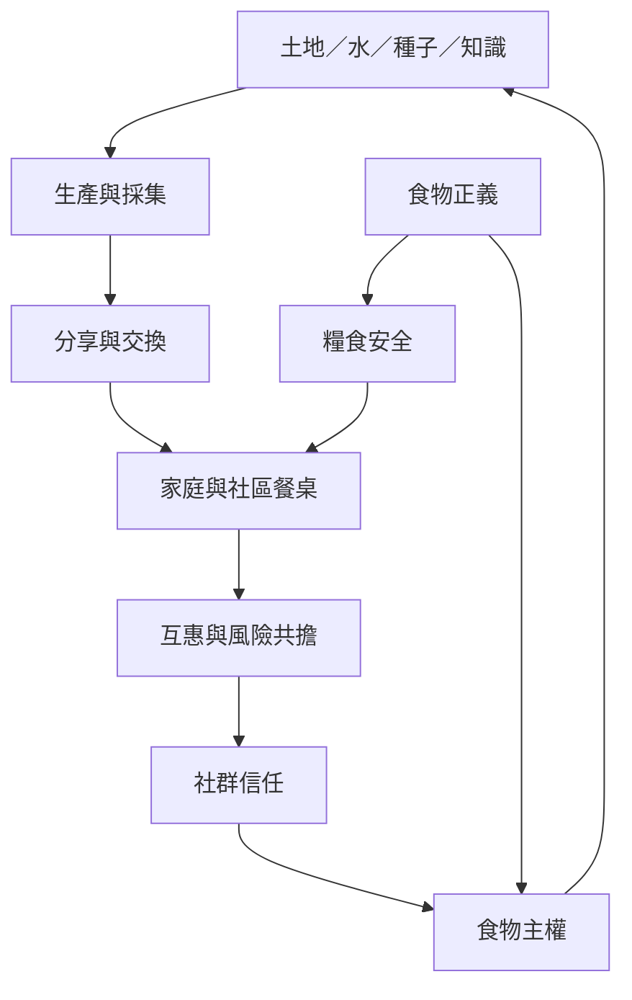

共食與食物分享連接從食物取得到社群決策的整條食物系統。互惠與食物主權讓餐桌不只處理分配，也能追問誰控制食物資源。

概念連結：[[食物主權 Food sovereignty]]、[[糧食安全 Food security]]、[[食物正義 Food justice]]、[[互惠 Reciprocity]]、[[共食是維繫社群關係的物質交換]]、[[共食應連接食物主權而不只追求餐桌熱鬧]]。

知識書導讀：[[Communal_meal]]
