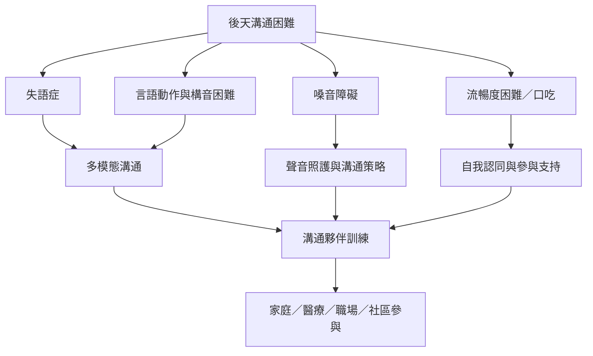

後天出現的溝通困難可能與腦中風、腦傷、神經退化、疾病、手術或其他身體狀況相關，也可能是長期存在但在特定生活階段才被辨認。失語症、構音或言語動作困難、嗓音障礙及口吃具有不同機制，不能以單一治療策略處理。共同的支持原則是尊重當事人目標、使用適切多模態方式、訓練夥伴並改善日常參與環境。

概念連結：[[失語症]]、[[構音障礙]]、[[言語失用症]]、[[口吃]]、[[嗓音障礙]]、[[輔助與替代溝通]]、[[溝通夥伴訓練]]。

## 參考
* ASHA Aphasia Practice Portal：<https://www.asha.org/practice-portal/clinical-topics/aphasia/>
* Stuttering lived-experience synthesis：<https://pubmed.ncbi.nlm.nih.gov/30696288/>
