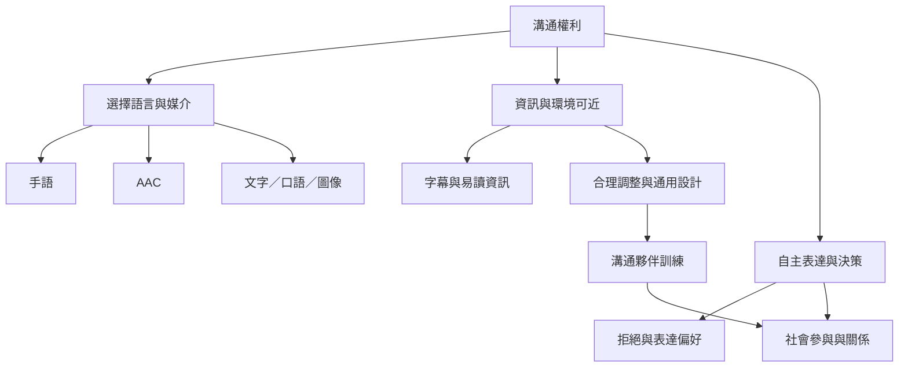

溝通權利關心的不只是某人能否說話，而是能否使用所選方式接收資訊、表達觀點、拒絕、選擇、建立關係並參與公共生活。CRPD 提供權利框架，ICF 幫助分析活動、參與與環境條件，而 AAC、手語、字幕、易讀資訊與溝通夥伴訓練則是實踐溝通可近性的不同方法。

概念連結：[[溝通權利]]、[[溝通可近性]]、[[輔助與替代溝通]]、[[手語]]、[[國際健康功能與身心障礙分類]]、[[溝通夥伴訓練]]、[[神經多樣性]]。

## 參考
* CRPD Articles 2, 9, 21：<https://www.un.org/development/desa/disabilities/convention-on-the-rights-of-persons-with-disabilities/>
* NJC Communication Bill of Rights：<https://www.njc-communication.org/communication-bill-of-rights-3rd-edition/>
