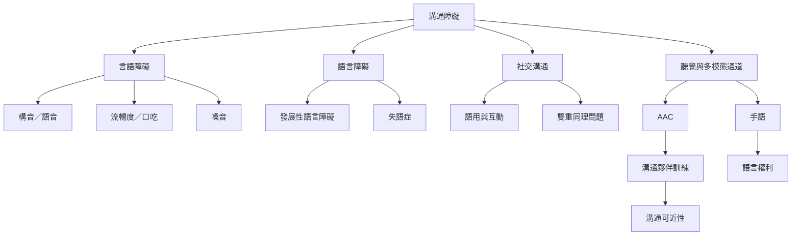

溝通障礙不是單一診斷，而是一組可能發生在語音、語言、聲音、流暢度、社交互動、聽覺與認知溝通的功能差異。不同功能可以共存，並可透過口語、文字、手勢、手語、圖像及 AAC 等多種通道獲得支持。分類是理解需求的工具，不是把個人縮減成診斷名稱。

概念連結：[[溝通障礙]]、[[言語障礙]]、[[語言障礙]]、[[發展性語言障礙]]、[[失語症]]、[[口吃]]、[[輔助與替代溝通]]、[[手語]]、[[社交溝通障礙]]、[[溝通可近性]]。

## 參考
* ASHA, Definitions of Communication Disorders：<https://www.asha.org/policy/RP1993-00208/>
* CRPD Article 2：<https://www.un.org/development/desa/disabilities/convention-on-the-rights-of-persons-with-disabilities/article-2-definitions.html>
