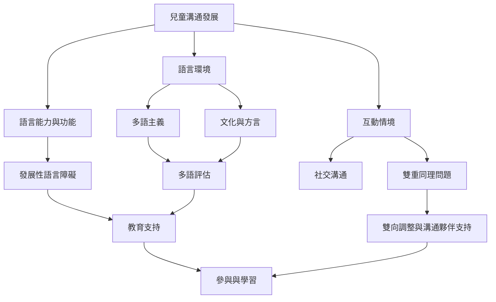

兒童與青少年的溝通發展，需要同時理解語言學習歷程、神經發展、家庭語言、教育環境與社會互動期待。DLD 共識強調功能影響與多種共存狀況；多語評估避免把語言差異誤診為障礙；神經多樣性與雙重同理觀點則提醒，互動困難可能來自雙方對訊號和節奏的不同理解。

概念連結：[[發展性語言障礙]]、[[多語主義]]、[[多語評估]]、[[動態評估]]、[[神經多樣性]]、[[雙重同理問題]]、[[社交溝通障礙]]。

## 參考
* CATALISE Phase 2：<https://pmc.ncbi.nlm.nih.gov/articles/PMC5638113/>
* ASHA Multilingual Service Delivery：<https://www.asha.org/practice-portal/professional-issues/multilingual-service-delivery/>
* Double empathy empirical research：<https://pubmed.ncbi.nlm.nih.gov/38149622/>
