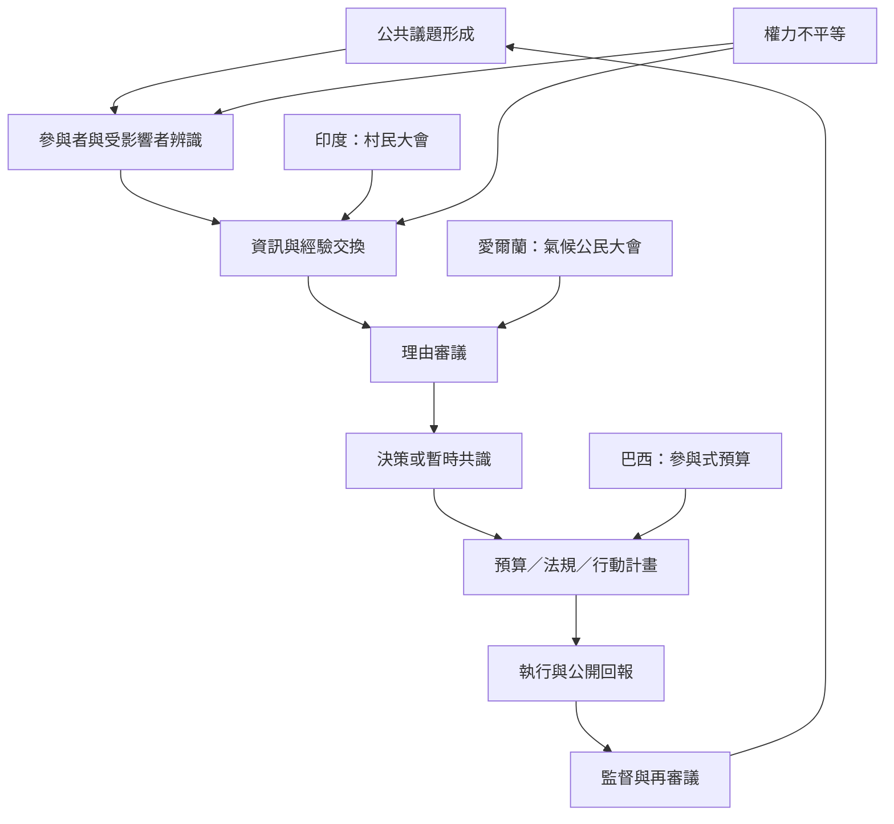

溝通行動的制度化，必須讓公民表達、理由交換、正式決策與執行回饋相互連接。巴西參與式預算、印度村民大會與愛爾蘭公民大會呈現不同制度脈絡，也顯示議程設定、回應品質、資源配置與制度持續性都是審議民主的重要條件。

核心概念：[[Deliberative_Democracy]]、[[Deliberative_System]]、[[Discourse_Ethics]]、[[Discursive_Inclusion]]、[[Communicative_Action]]。

進一步閱讀：[[印度村民大會顯示發言機會不等於被聽見]]、[[印度審議制度連結本土傳統與現代參與式治理]]、[[巴西參與式預算把討論轉換成財政優先順序]]、[[跨層級審議系統需串連線上線下場域]]、[[愛爾蘭氣候公民大會的溝通形式會影響提案採納]]。
