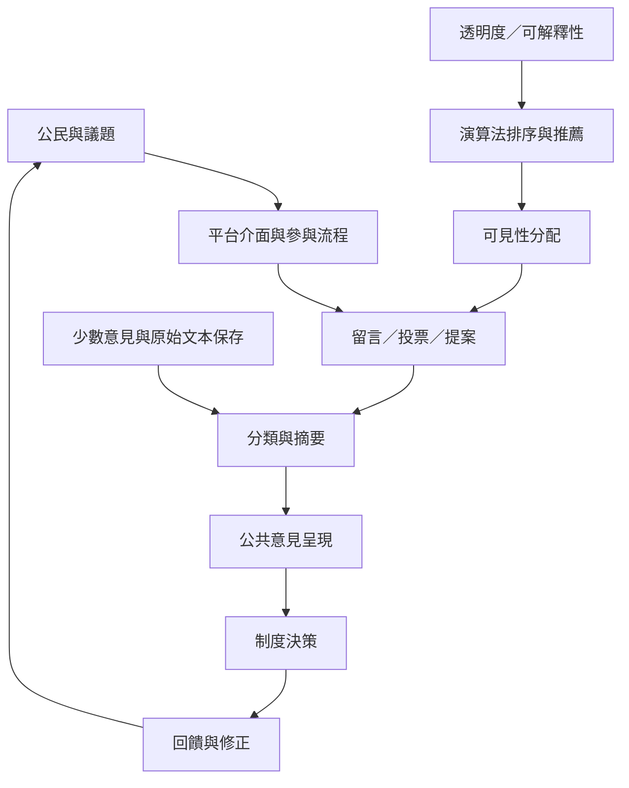

數位公共領域同時受到使用者互動、平台設計與演算法基礎設施塑造。vTaiwan 案例顯示平台能協助聚合意見，也可能將複雜立場壓縮成簡化分類；2026 年的演算法公共性論述則把分析焦點推向討論之前的可見性條件。

核心概念：[[Algorithmic_Public_Sphere]]、[[Public_Sphere]]、[[Deliberative_System]]、[[System]]、[[Validity_Claims]]。

進一步閱讀：[[台灣vTaiwan顯示平台演算法同時促進與限制公共討論]]、[[演算法能在對話開始前決定誰的內容可見]]、[[數位公共領域需審查可見性與資料排序規則]]、[[把平台演算法視為公共討論制度而非中性工具]]、[[讓AI參與討論時標示不確定性與證據來源]]。
