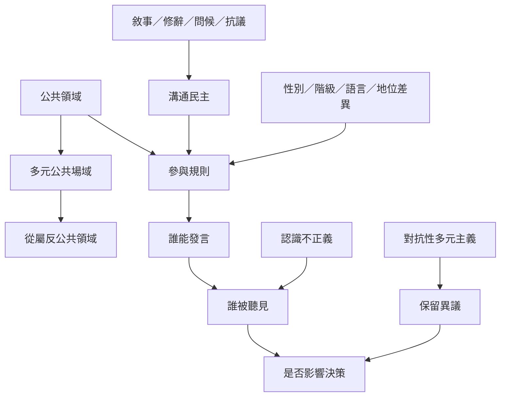

公共討論的形式平等不等於實質包容。女性主義、批判理論與溝通民主指出，群體需要能形成自身語言的場域，也需要敘事、修辭、情感和抗議等多種表達形式。共識的品質必須與權力差異、被聽見程度和異議能否存續一起評估。

核心概念：[[Public_Sphere]]、[[Subaltern_Counterpublics]]、[[Communicative_Democracy]]、[[Deliberative_Democracy]]、[[Discursive_Inclusion]]、[[Epistemic_Injustice]]、[[Agonism]]、[[Palaver]]、[[Ubuntu]]。

進一步閱讀：[[女性主義指出單一公共領域掩蓋結構性排除]]、[[民主溝通必須容納敘事修辭問候與抗議]]、[[女性主義批判要求重新檢查溝通理想的包容性]]、[[共識應該是可修正的成果不是不可質疑的前提]]。
