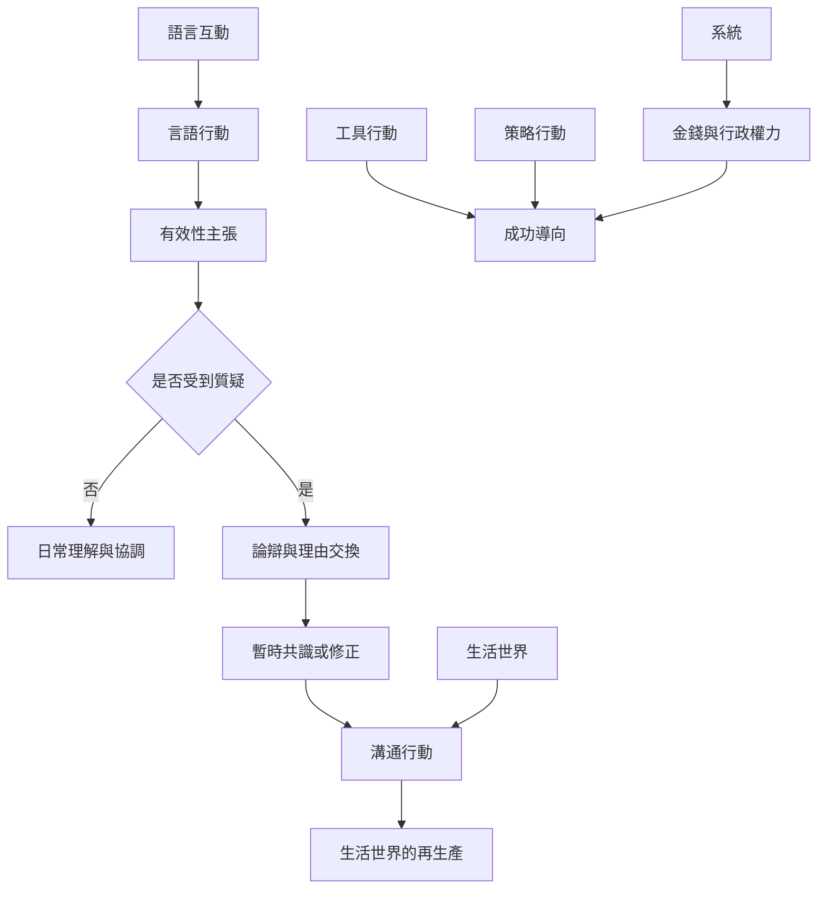

本圖整理哈伯瑪斯理論的核心鏈條：溝通行動以互相理解為導向，透過言語行動提出有效性主張；當主張受到質疑，參與者可進入論辯。與此相對，工具行動與策略行動以成功為導向。生活世界是溝通協調的背景，而系統則以金錢、權力等媒介協調複雜活動。

核心概念：[[Communicative_Action]]、[[Communicative_Rationality]]、[[Strategic_Action]]、[[Instrumental_Action]]、[[Validity_Claims]]、[[Speech_Act]]、[[Illocutionary_Act]]、[[Perlocutionary_Act]]、[[Formal_Pragmatics]]、[[Discourse_Ethics]]、[[Lifeworld]]、[[System]]、[[Colonization_of_the_Lifeworld]]。

進一步閱讀：[[溝通行動理論將互相理解視為協調行動的基礎]]、[[有效性主張使日常語句能接受理由檢驗]]、[[生活世界與系統透過不同機制整合社會]]、[[生活世界殖民化描述制度邏輯侵入日常互動]]。
