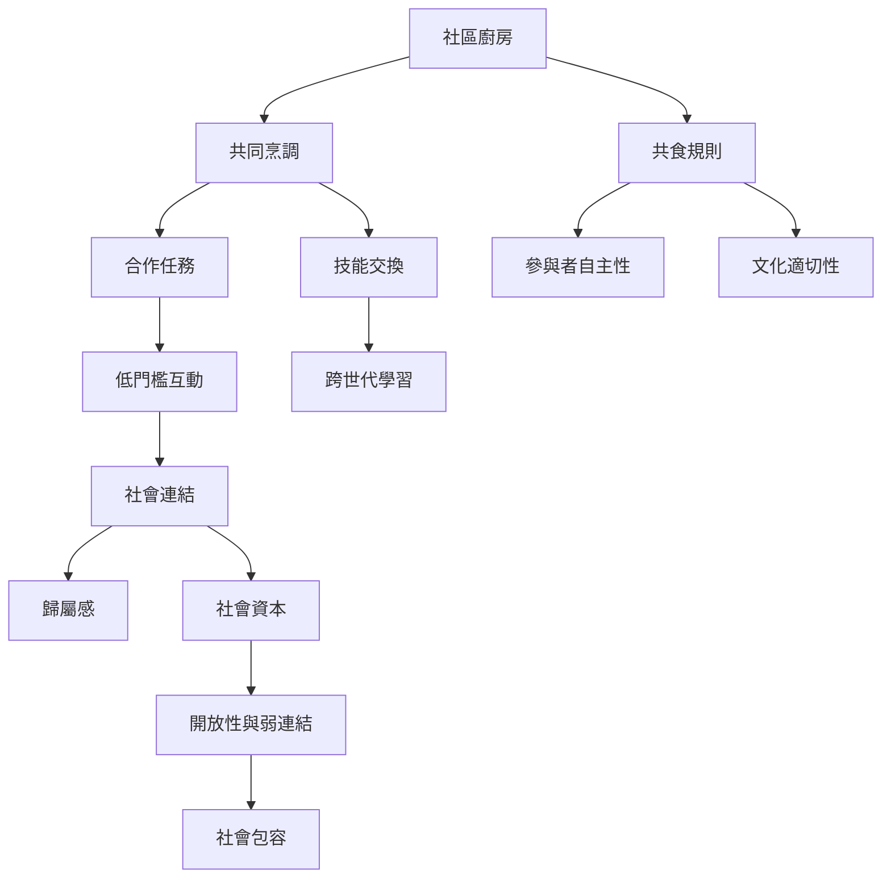

共食的社會價值不只是吃飯時同處一室，而是參與者共同建立規則、執行任務與交換知識。社區廚房可透過反覆共煮形成社會接觸，但要注意熟人網絡封閉、文化排除與參與者角色固定等風險。

## 思與行
* 設計能讓陌生人一起完成的小任務，並提供不同程度的參與方式。
* 用參與者回饋確認共食是否讓人感到自在、被尊重並能影響規則。

## 參考
* 核心筆記：[[共同烹調透過合作任務創造低門檻的社會連結]]、[[共食不是單純坐在同一桌而是共同建構用餐規則]]、[[社區廚房需要開放的弱連結而不只依靠熟人網絡]]。
* 相關概念：[[共食]]、[[共同烹調]]、[[社會資本]]、[[社會基礎設施]]、[[跨世代學習]]。
