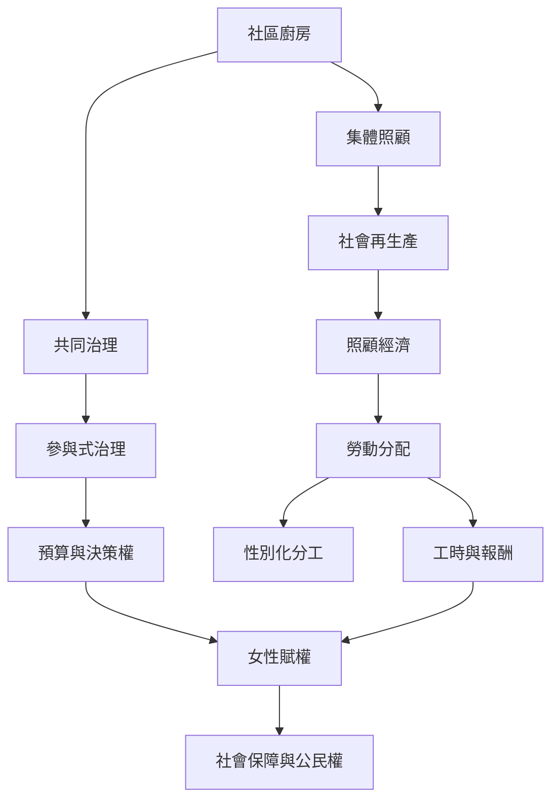

社區廚房把料理與照顧帶入公共空間，但若沒有重新分配權力與資源，可能複製家庭內部的性別化勞動。公平的廚房不只要供應餐食，也要承認工作者、安排報酬和休息、公開財務與共享決策。

## 思與行
* 以工時、補償、決策權與退出權檢查照顧勞動是否公平。
* 對志工與主要照顧者提供制度化支持，而不只以感謝與表揚代替。

## 參考
* 核心筆記：[[社區廚房的女性賦權必須包含勞動權與決策權]]、[[集體照顧不會自動消除性別化分工]]、[[社區廚房不能把志願服務當成無限供應的免費資源]]。
* 相關概念：[[照顧經濟]]、[[社會再生產]]、[[參與式治理]]、[[社會團結經濟]]。
