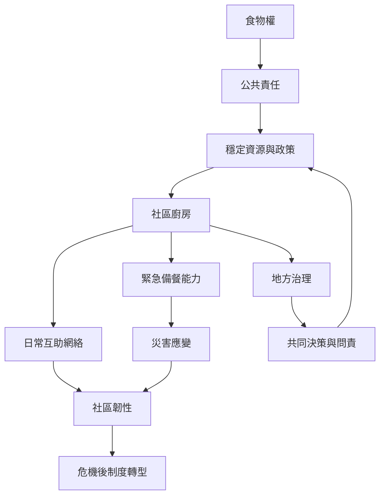

社區廚房能在危機時快速動員居民與食材網絡，但長期食物保障需要公共制度支持。最適合的關係不是國家把責任交給志工，而是公共部門保障基本權利與資源，社區保有在地判斷與參與治理。

## 思與行
* 平時建立跨機構聯絡與備援流程，危機時可以快速啟動。
* 危機後檢查社區組織是否獲得長期資源，避免把公共服務永久外包給居民。

## 參考
* 核心筆記：[[社區廚房必須補充而不能取代食物權的公共保障]]、[[危機中的共同備餐能快速形成地方互助但需要轉型機制]]、[[社區廚房需要透明而可交接的共同治理規則]]。
* 相關概念：[[食物權]]、[[社區韌性]]、[[互助]]、[[參與式治理]]、[[社會基礎設施]]。
