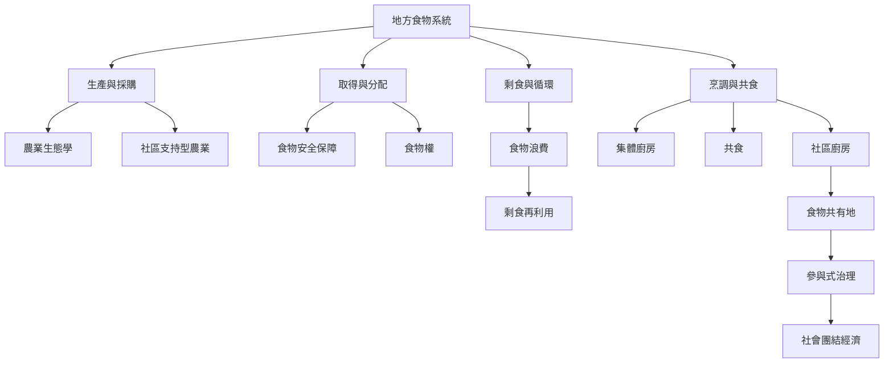

社區廚房位於食物系統的地方尺度，連接生產、採購、備餐、共食、食物再利用與治理。其角色可以從單一餐食服務，延伸為支持在地生產、食物安全、食物正義與社區互助的節點。

## 思與行
* 由一個實際生活圈出發，盤點食材從哪裡來、經過誰的手、在哪裡被料理與分享。
* 檢查社區廚房是否連結生產者、食物取得與廚餘循環，而不是只接在供餐末端。

## 參考
* 核心筆記：[[社區廚房可以把在地生產者與城市食物取得連成一個系統]]、[[社區廚房可以成為食物共有地與日常照顧基礎設施]]。
* 相關概念：[[社區廚房]]、[[食物安全保障]]、[[食物權]]、[[農業生態學]]、[[社區支持型農業]]、[[剩食再利用]]。
