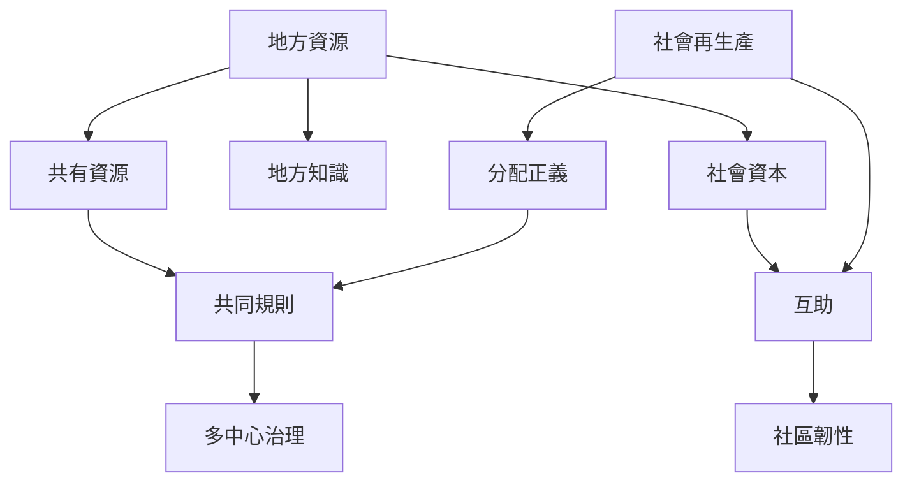

地方資源不只有金錢，也包括場地、自然資源、技能、時間、關係與地方知識。[[共有資源]]需要共同制定規則，並透過[[多中心治理]]連結不同尺度的制度。[[互助]]與[[社會資本]]能支持協作，但如果照顧與維護成本分配不均，就可能加重[[社會再生產]]的不平等。

建議閱讀：[[共有資源需要由使用者共同制定可問責的規則]]、[[自助與互助不能成為無酬勞動與國家撤退的藉口]]、[[跨社區聯盟能擴大地方行動的議價能力]]。
