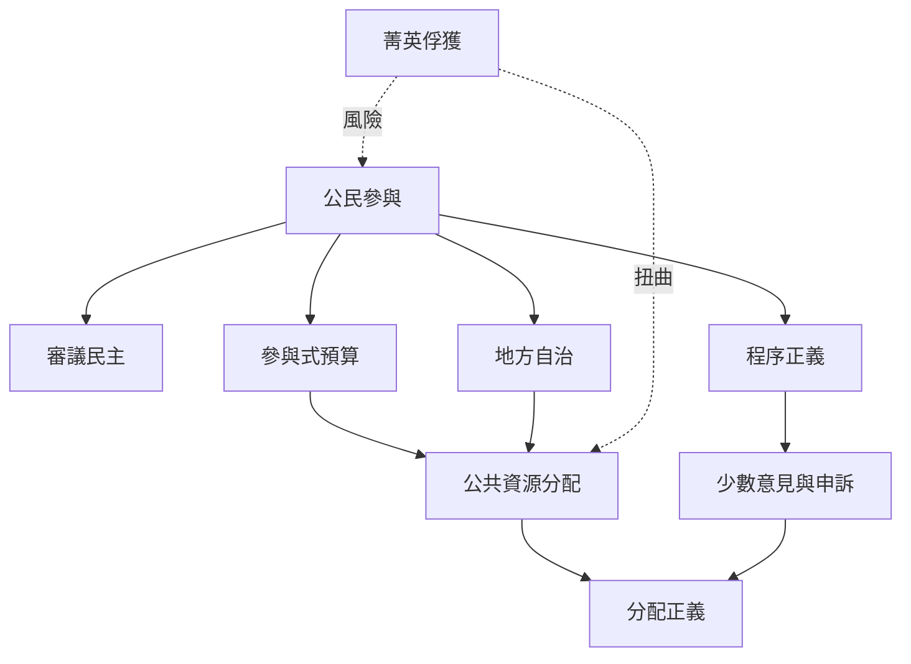

參與的核心問題是決策權如何分配，而不是居民是否被邀請。[[公民參與]]可以透過[[審議民主]]、[[參與式預算]]與地方規劃制度落實，但同時面臨[[菁英俘獲]]與程序排除。[[程序正義]]確保不同聲音能提出理由與申訴；[[分配正義]]則檢視最後的資源結果。

建議閱讀：[[參與必須以決策權而非出席人數衡量]]、[[社區參與需要讓異議者也能改變議程]]、[[地方自治需要財政權限與行政能力同時下放]]。
