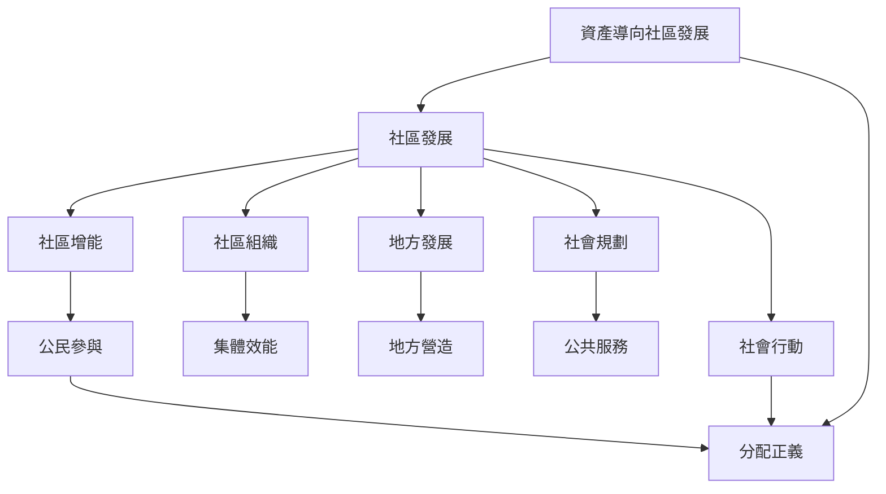

社區發展可視為一個由價值、組織、介入策略與評估所構成的實踐場域。[[社區發展]]連結[[社區增能]]與[[社區組織]]；方法上需在[[地方發展]]、[[社會規劃]]與[[社會行動]]之間選擇或混合。資產導向方法提供地方行動起點，但必須和[[分配正義]]及公共制度支援並行。

建議閱讀：[[社區發展是集體增能與社會改變的實踐]]、[[資產導向方法應與結構性改革並行]]、[[社區組織需要兼顧關係建立與權力分析]]。
