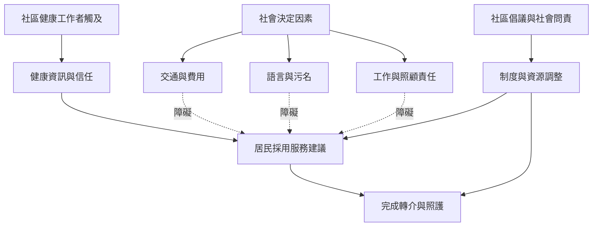

CHW 能增加服務觸及，但公平性還取決於居民能否採用建議、完成轉介、負擔交通與費用，以及制度是否回應社會決定因素。

## 雙向概念連結
[[健康公平關注可避免且不公正的健康差異]]、[[健康的社會決定因素形塑人們健康機會的分布]]、[[全民健康覆蓋要求有需要的人能取得可負擔的服務]]、[[社區參與要求居民共同定義問題並影響決策]]、[[社會問責使制度必須回應受服務者與工作者]]

## 延伸筆記
[[服務觸及弱勢不等於消除健康不平等]]、[[社區健康工作者能把醫療導航延伸到社會支持]]、[[社區健康成效不能只用接觸量和轉介量衡量]]

## 參考
* 全書導讀：[[Community_health_worker]]
