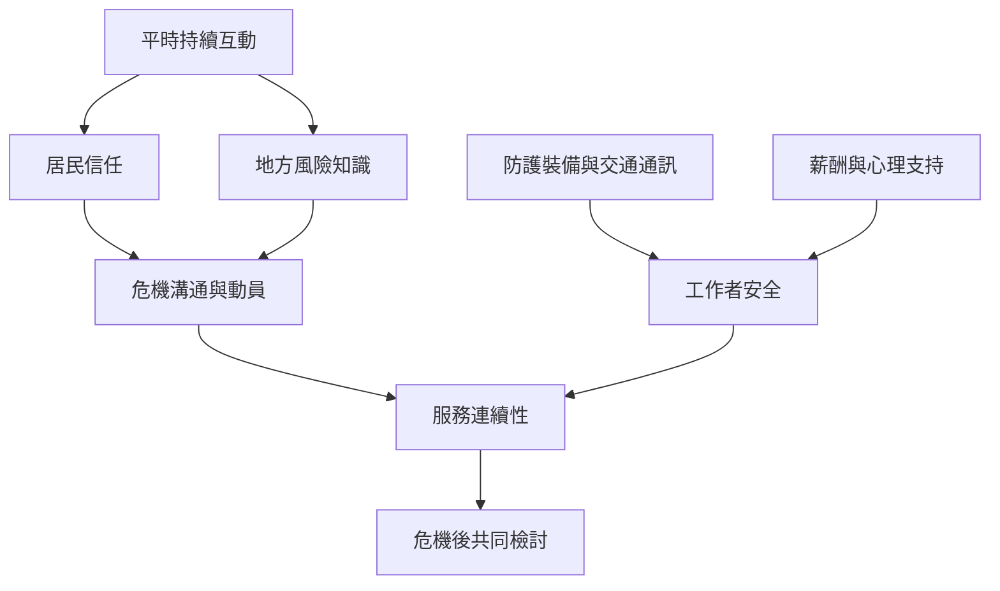

CHW 的危機功能不是獨立的應急人力，而是平時社區連結、健康資訊、服務導航與團隊協作的延伸。危機時需要安全裝備、心理支持、合理報酬與明確任務。

## 雙向概念連結
[[危機韌性是社區與制度在衝擊中維持及恢復健康服務的能力]]、[[信任是人們願意分享資訊並接受合作的關係條件]]、[[體面勞動保障薪酬安全休息權利與發展機會]]、[[基層健康照護以可近性連續性與社區參與為核心]]、[[支持性督導以持續回饋協助工作者改進實務]]

## 延伸筆記
[[危機應變能力來自平時累積的社區信任]]、[[獅子山疫情研究揭示前線任務擴張需要安全與心理支持]]、[[孟加拉海地與肯亞的疫情研究顯示既有信任能支撐社區應變]]

## 參考
* 全書導讀：[[Community_health_worker]]
