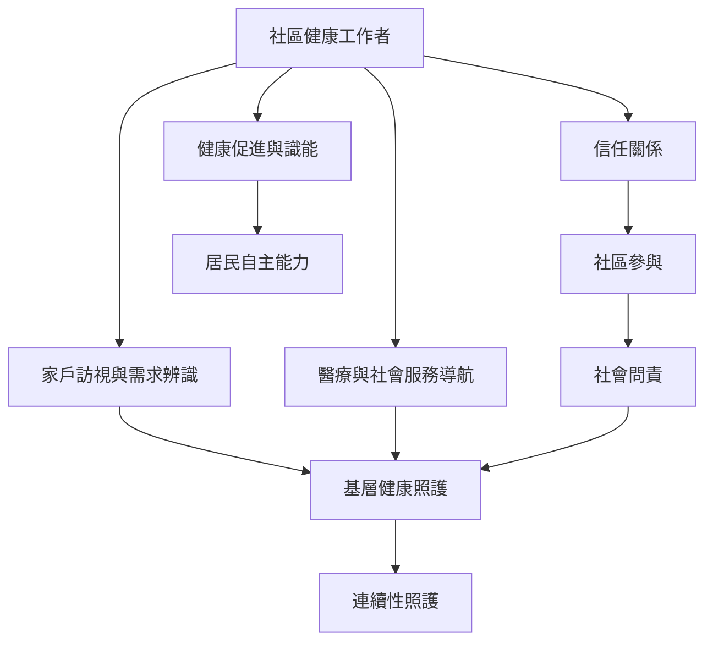

CHW 方案的核心在於連接居民、家庭、社區組織與基層醫療團隊。這張圖把工作角色、信任、健康促進、醫療導航與團隊整合放在同一個系統中。

## 雙向概念連結
[[社區健康工作者是社群與健康服務之間的可信任橋梁]]、[[基層健康照護以可近性連續性與社區參與為核心]]、[[信任是人們願意分享資訊並接受合作的關係條件]]、[[健康促進讓個人與社群增加健康自主能力]]、[[健康識能是取得理解評估與運用健康資訊的能力]]、[[社區參與要求居民共同定義問題並影響決策]]、[[全民健康覆蓋要求有需要的人能取得可負擔的服務]]

## 延伸筆記
[[社區健康工作者以信任關係連接醫療體系與日常生活]]、[[社區健康工作者能把醫療導航延伸到社會支持]]、[[敘事聆聽使社區健康工作不只傳遞衛教訊息]]

## 參考
* 全書導讀：[[Community_health_worker]]
