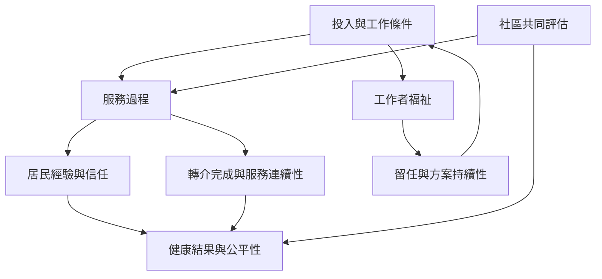

以接觸次數和服務量評估 CHW 容易忽略信任、關係、居民自主、轉介閉環、公平性與工作者福祉。多層次評估應同時考慮投入、過程、結果與制度改善。

## 雙向概念連結
[[成效評估以多層次指標檢視服務與制度結果]]、[[成本效益分析比較健康成果與資源投入的關係]]、[[數位健康運用數位技術支援健康服務與資訊流程]]、[[信任是人們願意分享資訊並接受合作的關係條件]]、[[健康公平關注可避免且不公正的健康差異]]、[[體面勞動保障薪酬安全休息權利與發展機會]]

## 延伸筆記
[[社區健康成效不能只用接觸量和轉介量衡量]]、[[2025年成本效益回顧支持投資社區健康工作者但提醒證據異質]]、[[數位工具只有減輕負擔並保護隱私才有價值]]

## 參考
* 全書導讀：[[Community_health_worker]]
