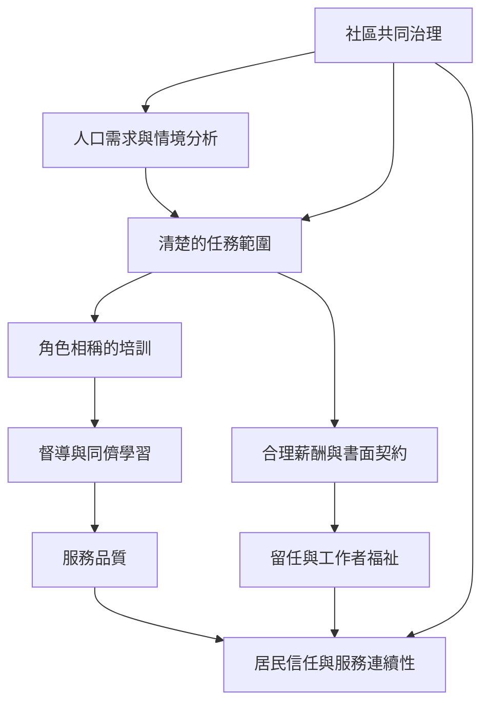

方案品質不是靠個人奉獻撐起來，而是由任務界線、適切培訓、合理薪酬、支持性督導、供應鏈、職涯和社區治理共同形成。

## 雙向概念連結
[[培訓是建立執行特定健康任務所需知識與技能的過程]]、[[支持性督導以持續回饋協助工作者改進實務]]、[[體面勞動保障薪酬安全休息權利與發展機會]]、[[志願服務以自願投入為基礎但不等於可無限取用勞動]]、[[專業化建立職能標準保障與職涯路徑]]、[[社區參與要求居民共同定義問題並影響決策]]

## 延伸筆記
[[培訓內容必須跟任務範圍和工作量同步]]、[[合理薪酬是社區健康方案的基本基礎設施]]、[[支持性督導應以回饋和能力建構取代監控]]、[[無償志願工作可能把公共照護成本轉嫁給女性]]

## 參考
* 全書導讀：[[Community_health_worker]]
