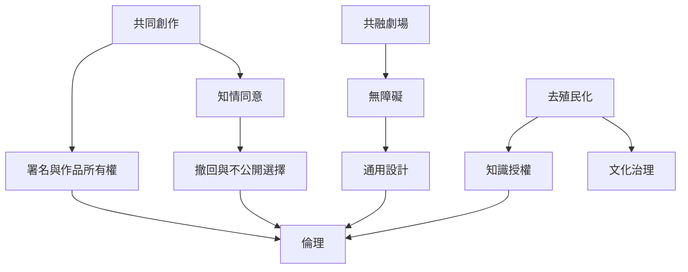

這張地圖把倫理視為持續協商，而不是創作前的一張同意書。共融、無障礙與去殖民化都要求重新分配知識、時間、表達與決策權。

## 延伸閱讀
* [[term/倫理]]、[[term/知情同意]]、[[term/共融劇場]]、[[term/無障礙]]、[[term/通用設計]]、[[term/去殖民化]]。
* [[note/共同創作的倫理包括決策權與成果署名]]、[[note/無障礙不是額外服務而是共同創作的基本條件]]、[[note/原住民族表演知識不能被當成無主的創作素材]]。
* [[idea/設計一份涵蓋署名錄影與退出權的共同創作協議]]、[[idea/為共融劇場設計多種表達節奏與參與角色]]、[[idea/讓原住民族合作從知識授權與治理關係開始]]。
