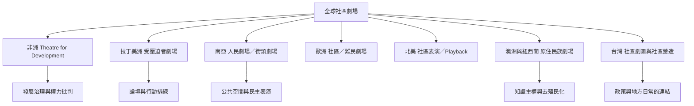

這張地圖以區域與組織歷史作為比較軸線。它提醒讀者：社區劇場不只是一套來自歐美的輸出方法，而是在不同社會運動、原住民族知識、公共政策與地方生活中形成多條譜系。

## 延伸閱讀
* [[note/社區劇場的全球案例必須放回地方歷史比較]]、[[note/地方脈絡決定參與式劇場的形式]]、[[note/去殖民化要求改變知識與決策權的來源]]。
* [[data/奈及利亞農村劇場顯示地方團體能把表演轉化為發展行動]]、[[data/印度人民劇場以互動表演回應民主與排除問題]]、[[data/倫敦難民社群劇場讓身份與歸屬成為可被共同演述的問題]]、[[data/紐西蘭 Theatre Marae 以 Māori 知識體系重構研究與劇場教學]]、[[data/石岡媽媽劇團案例揭示台灣社區劇場與政策脈絡的拉扯]]。
* [[term/發展劇場]]、[[term/受壓迫者劇場]]、[[term/popular theatre]]、[[term/去殖民化]]、[[term/地方文化發展]]。
