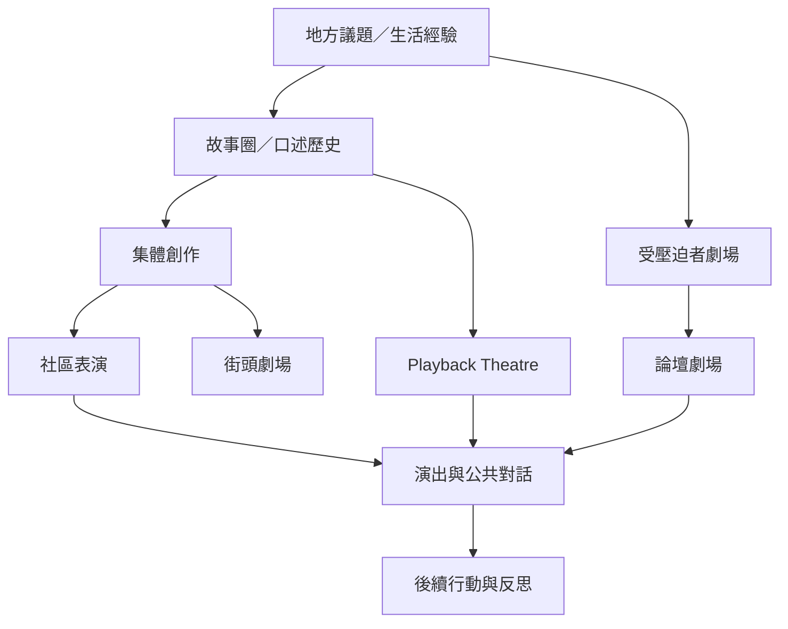

本圖比較不同方法如何組織素材、觀眾與行動。它們不是固定配方，可按社群情境調整；方法的名稱也不能取代對創作權與關係倫理的檢查。

## 延伸閱讀
* [[term/受壓迫者劇場]]、[[term/論壇劇場]]、[[term/Playback Theatre]]、[[term/集體創作]]、[[term/故事圈]]、[[term/口述歷史]]、[[term/街頭劇場]]。
* [[note/論壇劇場讓觀眾在安全邊界內排練改變]]、[[note/Playback Theatre 讓個人敘事在群體見證中被回演]]、[[note/地方故事能同時凝聚社群與挑戰社群規範]]。
* [[idea/從社區散步開始蒐集地方劇本而不是先決定演出主題]]、[[idea/用複合虛構角色處理敏感故事而不要求參與者自我揭露]]。
