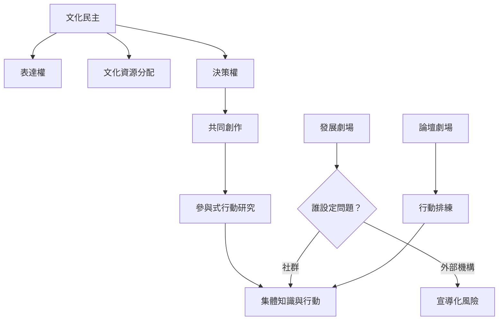

此圖將參與式劇場放在權力與文化民主的框架中。參與不等於互動；若參與者不能決定議題、詮釋與資源，互動仍可能只是單向宣導的包裝。

## 延伸閱讀
* [[term/文化民主]]、[[term/公民參與]]、[[term/參與式行動研究]]、[[term/共同創作]]、[[term/發展劇場]]。
* [[note/參與應從觀看延伸到議題設定與決策權]]、[[note/發展劇場若由外部機構定義問題就可能失去解放性]]、[[note/社區劇場可以成為民主行動的排練場]]。
* [[idea/辦一場誰能決定故事的共議工作坊]]、[[idea/以論壇劇場排練地方公共議題的不同解方]]。
* 核心研究：[[data/非洲發展劇場一旦由資助者主導就可能從對話變成宣導]]、[[data/印度人民劇場以互動表演回應民主與排除問題]]。
