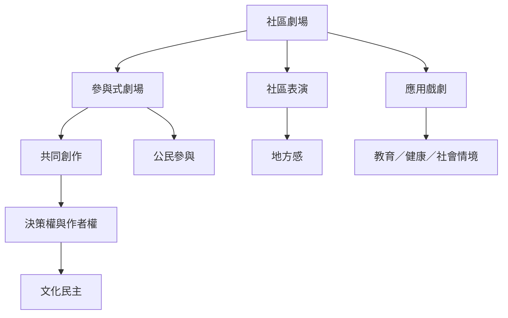

這張地圖從「誰參與、以何種方式參與、參與如何影響作品」出發，區分社區劇場、應用戲劇、社區表演與參與式劇場。形式可以多樣，但判斷核心是社群是否能共同定義問題、創作與決定作品的命運。

## 延伸閱讀
* [[term/社區劇場]]、[[term/參與式劇場]]、[[term/應用戲劇]]、[[term/社區表演]]。
* [[note/社區劇場的核心是社群對創作與決策擁有實質作者權]]、[[note/參與應從觀看延伸到議題設定與決策權]]、[[note/地方脈絡決定參與式劇場的形式]]。
* [[idea/從社區散步開始蒐集地方劇本而不是先決定演出主題]]、[[idea/用共餐與故事圈建立低門檻的社區劇場小組]]。
* 比較案例：[[data/六國比較研究揭示社區劇場如何在不同地方形成自己的方法]]、[[data/石岡媽媽劇團案例揭示台灣社區劇場與政策脈絡的拉扯]]。
