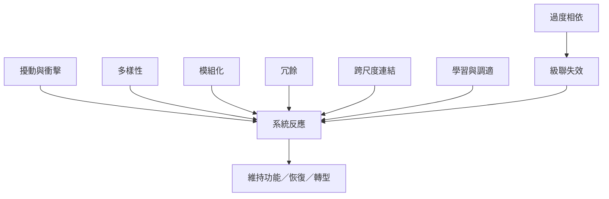

本圖將韌性視為多種能力的組合，而非單一分數。多樣性、模組化、冗餘、跨尺度連結與學習能力共同影響系統面對衝擊的方式；但連結太密也可能造成級聯失效。閱讀時應同時比較[[韌性]]與[[穩健性]]，並考慮[[臨界轉變]]。

## 參考
* 延伸閱讀：[[穩健性與韌性描述不同的系統能力]]、[[系統韌性需要多樣性、模組與跨尺度連結共同支撐]]、[[非線性讓微小擾動可能造成巨大後果也可能被吸收]]。
* 概念：[[韌性]]、[[穩健性]]、[[模組化]]、[[冗餘]]、[[臨界轉變]]。
* 回到總覽：[[Complex_adaptive_system]]。
