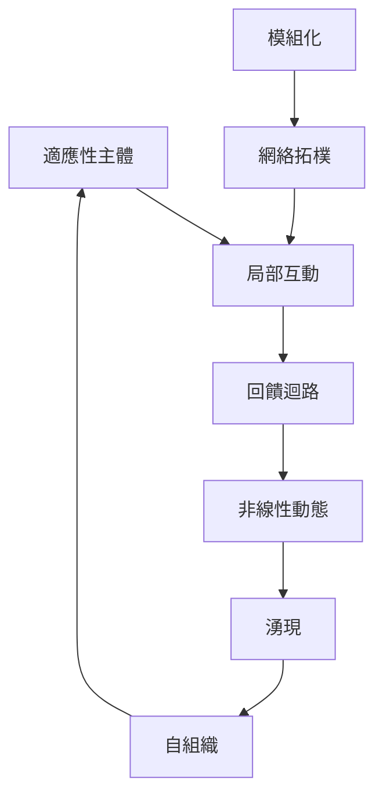

本圖整理核心機制：適應性主體依局部資訊互動，產生回饋與非線性動態，進一步形成湧現與自組織；網絡結構與模組化會改變互動路徑。核心閱讀可從[[複雜適應系統]]、[[適應性主體]]與[[湧現]]開始，再連到[[回饋迴路]]、[[網絡科學]]及[[模組化]]。

## 參考
* 延伸閱讀：[[複雜適應系統是由互相回應的主體共同演化的開放系統]]、[[互動主體的局部規則會生成無法由個體直接預見的整體模式]]、[[回饋迴路讓系統的結果反過來改變下一輪行動]]、[[網絡拓樸會改變資訊傳播與集體行為]]、[[模組化讓局部試驗不必立即擾動整個系統]]。
* 來源脈絡：[[複雜適應系統由持續適應的主體與環境共同生成]]、[[網絡結構與回饋共同塑造複雜網絡中的湧現]]。
* 回到總覽：[[Complex_adaptive_system]]。
