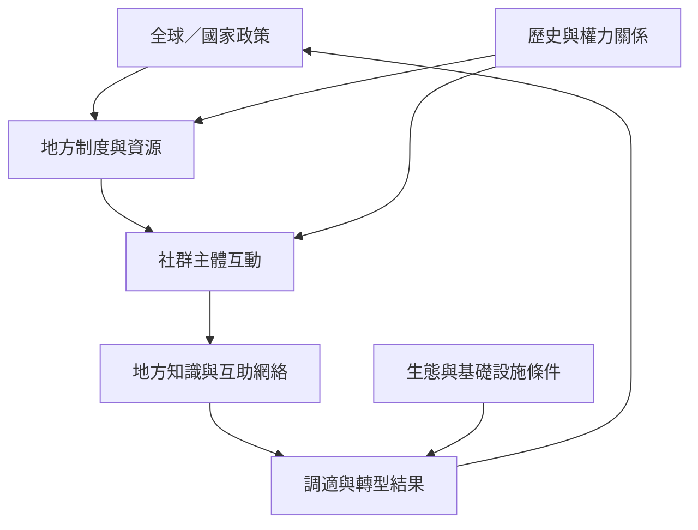

本圖比較不同地區案例中的共同主題：地方知識、非正式網絡、制度自主與權力關係會共同影響調適結果。跨地區比較可以辨識共通機制，但不能假定相同制度在不同社會脈絡中會產生相同效果。

## 參考
* 非洲：[[肯亞醫院案例顯示制度資源與前線自主會共同塑造決策]]。
* 南亞：[[尼泊爾社區林業顯示協作式調適必須擴大邊緣群體的發言權]]、[[尼泊爾社區制度的調適能力會受社會邊緣化與多尺度政治限制]]。
* 拉丁美洲：[[拉丁美洲城市水治理需要把地方知識納入跨尺度制度設計]]、[[南美洲流域委員會的危機經驗暴露參與治理的制度限制]]。
* 東亞與中國：[[日本吳市災後地下水網絡展現非正式行動者的補位能力]]、[[中國鄉村轉型是地方政府企業與村落共同演化的結果]]。
* 太平洋與東南亞：[[巴布亞紐幾內亞原住民社群以多種知識共同回應複合氣候風險]]、[[菲律賓印尼與馬爾地夫案例顯示社群會協商甚至抵抗調適制度]]。
* 回到總覽：[[Complex_adaptive_system]]。
