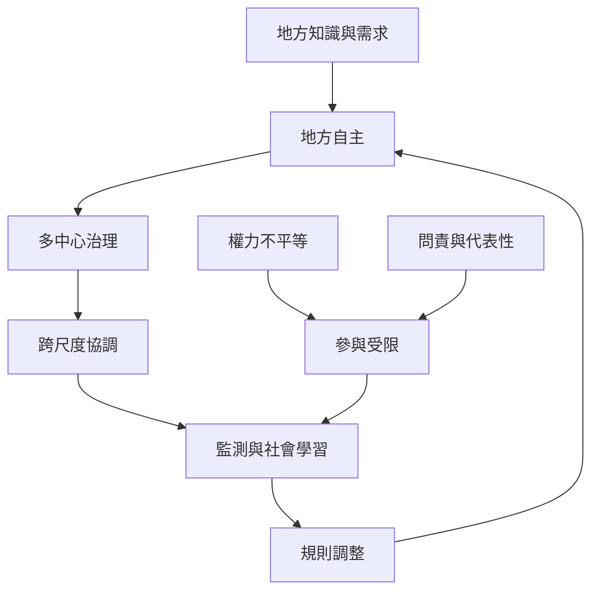

本圖呈現治理面的張力：地方自主有助利用在地知識，多中心治理連結不同尺度，社會學習則讓規則隨證據調整；但權力不平等可能讓參與平台再製排除。治理設計需同時處理[[調適性治理]]、[[多中心治理]]與[[權力不平等]]。

## 參考
* 延伸閱讀：[[多中心治理能讓不同尺度的決策互相校正]]、[[多方參與若未處理權力不平等仍可能再製排除]]、[[地方知識是系統調適能力的一部分而非附加意見]]、[[公共政策應以回饋式學習取代一次性設計]]。
* 案例：[[肯亞醫院案例顯示制度資源與前線自主會共同塑造決策]]、[[拉丁美洲城市水治理需要把地方知識納入跨尺度制度設計]]。
* 回到總覽：[[Complex_adaptive_system]]。
