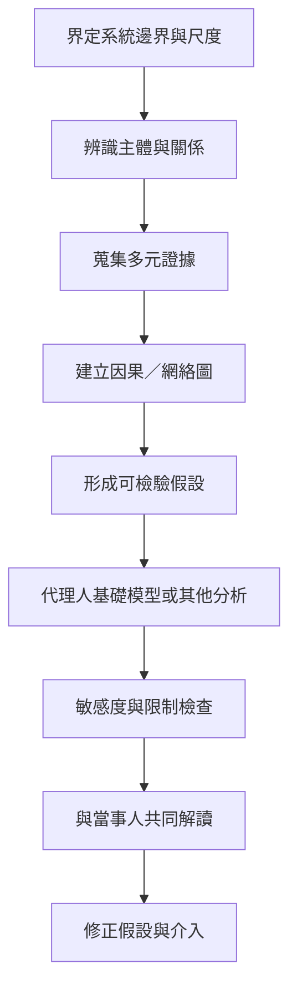

本圖整理研究方法：先界定系統邊界與尺度，再辨識主體與網絡，結合質性訪談、文件分析、觀察、系統圖與代理人基礎模型；最後透過資料、敏感度分析與參與者檢視模型假設。方法選擇應依問題，而不是為了使用某個模型而改寫問題。

## 參考
* 延伸閱讀：[[分析結論必須對應系統邊界與時間尺度]]、[[代理人基礎模型讓微觀互動假設可以被比較]]、[[複雜性不是替未知貼上的萬用標籤]]。
* 方法案例：[[中國城市洪災模型把信任與資源限制納入多主體互動]]、[[肯亞醫院案例顯示制度資源與前線自主會共同塑造決策]]。
* 回到總覽：[[Complex_adaptive_system]]。
