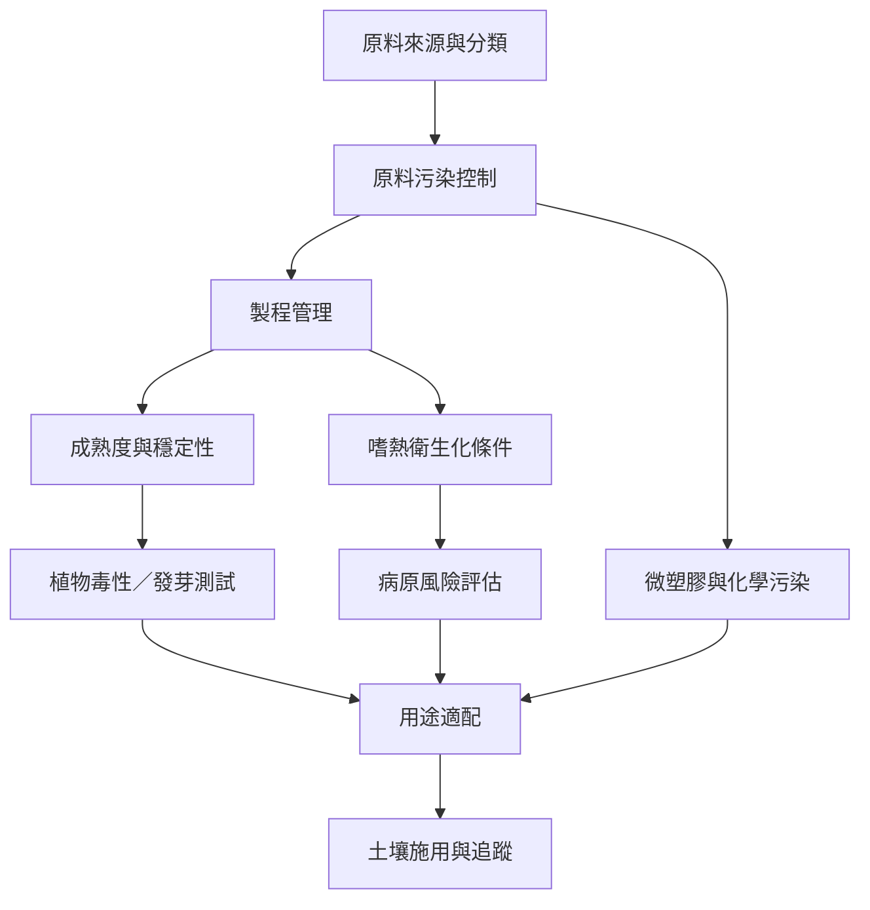

堆肥的品質不是單一「成熟／未成熟」標籤，而是一組用途相關的判斷。熟成度回答分解是否穩定，衛生指標回答病原風險，化學與物理污染檢測回答原料是否把危害帶回土壤，農藝測試則回答產品是否適合特定作物與土壤。源頭分流、製程管理與成品檢測必須互相補足。

## 核心永久筆記
* [[堆肥品質從原料分流開始]]
* [[堆肥成熟度需要多種指標交叉判斷]]
* [[原料污染無法單靠後端篩分完全解決]]
* [[堆肥品質需要同時處理生物風險與化學污染]]
* [[堆肥成品的信任需要透明的原料與品質資訊]]
* [[堆肥是土壤改良材而不必然是完整肥料]]
* [[全球204項研究的統合分析比較堆肥與化學肥料對土壤及產量的影響]]
* [[家庭堆肥與工業堆肥的原料邊界不同]]

## 概念詞彙
* [[堆肥成熟度（Compost maturity）]]、[[堆肥原料（Feedstock）]]、[[發芽指數（Germination index）]]
* [[微塑膠（Microplastics）]]、[[全氟和多氟烷基物質（PFAS）]]、[[病原降低（Pathogen reduction）]]
* [[堆肥滲出液（Leachate）]]、[[嗜熱階段（Thermophilic phase）]]

## 延伸行動
* [[讓居民共同檢查堆肥中的塑膠與可疑原料]]

## 文獻基礎
* [[微塑膠系統性回顧指出堆肥可能成為塑膠進入土壤的途徑]]
* [[研究發現可堆肥餐具可能把PFAS帶入堆肥成品]]
* [[歐盟廢棄物框架指令要求生物廢棄物分流並提升再利用品質]]
* [[堆肥成熟度評估綜述指出單一指標不足以判斷成品]]
