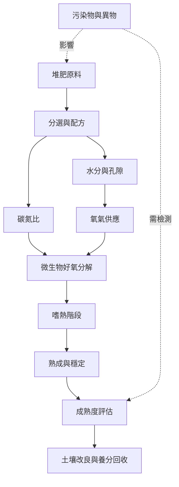

堆肥流程可視為一組互相制約的生物與工程條件：原料決定可分解物與污染負荷，碳氮比、水分、粒徑與氧氣共同影響微生物活動；過程中的升溫、熟成與品質檢查，再決定材料能否安全地回到土壤。這張地圖聚焦「材料如何變成穩定堆肥」。

## 核心永久筆記
* [[堆肥是受控的好氧生物分解而不是單純的腐爛]]
* [[堆肥厭氧消化與發酵是不同的有機物處理路徑]]
* [[碳氮比是配方起點而不是萬用答案]]
* [[水分與氧氣必須一起管理]]
* [[嗜熱階段有助降低病原但不等於每個堆體都已安全]]
* [[堆肥成熟度需要多種指標交叉判斷]]
* [[Bokashi發酵物不是可直接等同成熟堆肥]]
* [[堆肥改善土壤的價值不只在於提供養分]]
* [[堆肥不是零排放技術而是需要管理的生物程序]]

## 概念詞彙
* [[堆肥（Compost）]]、[[堆肥化（Composting）]]、[[好氧分解（Aerobic decomposition）]]
* [[碳氮比（C:N ratio）]]、[[堆肥原料（Feedstock）]]、[[嗜熱階段（Thermophilic phase）]]
* [[堆肥成熟度（Compost maturity）]]、[[蚯蚓堆肥（Vermicomposting）]]、[[條垛堆肥（Windrow composting）]]、[[靜態充氣堆（Aerated static pile）]]
* [[堆肥滲出液（Leachate）]]、[[發芽指數（Germination index）]]、[[病原降低（Pathogen reduction）]]、[[Bokashi發酵（Bokashi fermentation）]]

## 延伸行動
* [[用一份簡單堆肥日誌把照顧轉為可觀察的實驗]]

## 文獻基礎
* [[FAO農場堆肥指南提供碳氮比與溫度的實務範圍]]
* [[美國環保署家庭堆肥指南說明原料選擇與日常管理]]
* [[堆肥成熟度評估綜述指出單一指標不足以判斷成品]]
* [[蚯蚓堆肥系統性回顧比較廢棄物回收與氣體排放]]
* [[氮循環綜述說明堆肥會發生氮流失與氣體排放]]
* [[堆肥手冊與書籍提供不同尺度的實務知識]]
* [[2026年城市Bokashi試驗描繪家庭發酵中的微生物群落]]
