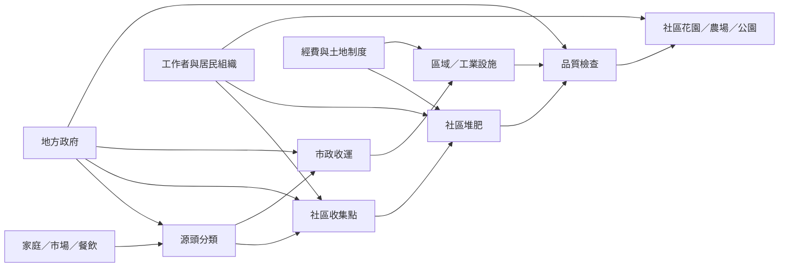

社區堆肥是連結家庭、商家、公共空間、農業與市政系統的治理網絡。其運作不只是把有機廢棄物放進設備，而是要把原料收集、場地、工作、操作、品質檢驗、成品使用與資金安排接起來。集中式與分散式可以互補，真正的尺度選擇取決於物料來源、人口密度、交通、土地與地方能力。

## 核心永久筆記
* [[社區堆肥的核心是治理而不只是設備]]
* [[分散式堆肥讓有機物留在地方但需要穩定的制度支持]]
* [[市政堆肥需要把源頭分類處理設施與成品用途接成一條鏈]]
* [[社區堆肥的環境效益需要完整的物質流帳本]]
* [[堆肥改善土壤的價值不只在於提供養分]]

## 概念詞彙
* [[社區堆肥（Community composting）]]、[[循環生物經濟（Circular bioeconomy）]]
* [[堆肥化（Composting）]]、[[厭氧消化（Anaerobic digestion）]]、[[堆肥原料（Feedstock）]]
* [[土壤有機質（Soil organic matter）]]

## 延伸行動
* [[把社區堆肥設計成可共同照顧的公共基礎設施]]
* [[讓剩食餐桌與堆肥教育形成一條地方食物循環]]
* [[建立社區堆肥的公開物質流帳本]]
* [[建立鄰里原料與成熟堆肥的在地媒合地圖]]

## 文獻基礎
* [[聯合國環境規劃署亞洲城市堆肥指引強調源頭分類與可行性評估]]
* [[美國環保署社區堆肥指南將在地循環視為社區資產]]
* [[印度四座城市的分散式堆肥研究比較十七個計畫]]
* [[坦尚尼亞KIWODET案例顯示社區堆肥受土地與市場關係制約]]
* [[象牙海岸Tiassale案例量化分散式堆肥的物質流與減排潛力]]
* [[巴西聖保羅社區堆肥研究呈現公民組織的環境與社會效益]]
* [[迦納阿克拉有機廢棄物計畫將綠色工作與社區堆肥連結]]
* [[臺灣環境部與臺中市政府提供廚餘堆肥及回收資訊]]
