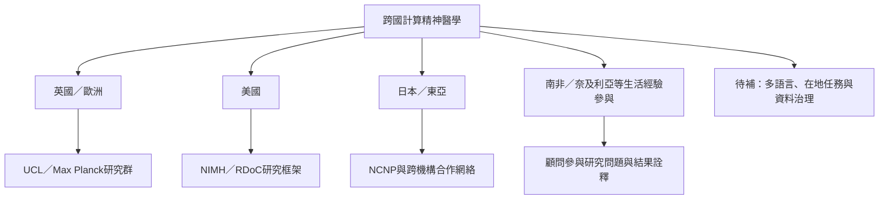

現有材料可見英國與歐洲的 UCL／Max Planck 研究網絡、美國的 NIMH 與多所大學、日本 NCNP 的計算論精神醫學研究室，以及南非、奈及利亞等地生活經驗顧問參與的跨診斷回顧。這是跨區域的入口集合，不等於全球研究分布的完整盤點；尤其低中收入國家、多語言樣本與非英語研究仍需主動追補。

## 思與行
* 以研究者、研究中心、任務資料庫與在地合作組織四條線擴展來源。
* 對每一地區記錄資料集、語言、招募方式與參與者的實際決策權。

## 參考
* [[日本已建立計算論精神醫學研究室與跨機構研究網絡]]。
* [[患者與生活經驗顧問能改變研究問題及結果解釋]]；[[文化情境會改變同一計算參數的意義]]。
