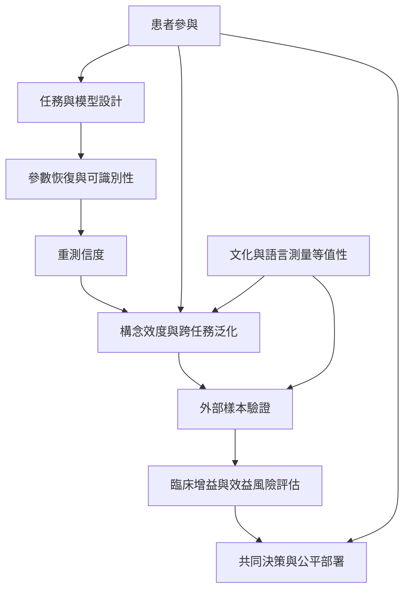

臨床轉譯需要跨越多道門檻：測量是否可靠、參數是否可識別、構念是否有效、結果能否泛化、是否增加臨床決策價值，以及是否尊重患者自主與文化差異。計算模型只有通過這些檢驗，才可能成為臨床輔助工具。

## 思與行
* 把模型部署視為需要證據門檻的臨床介入，不是研究程式移植。
* 讓患者、照護者、臨床人員與資料科學家一起檢視錯誤成本。

## 參考
* [[計算表型必須經過構念效度與縱向信度檢驗]]。
* [[模型可計算不代表它已具備臨床效用]]；[[患者參與是知識品質的一部分而不是禮貌程序]]；[[文化情境會改變同一計算參數的意義]]。
